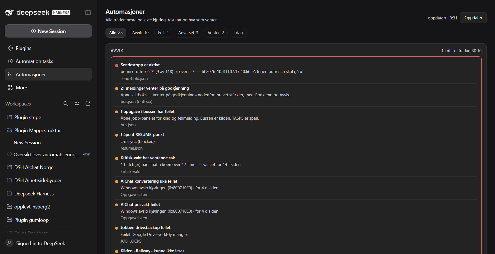
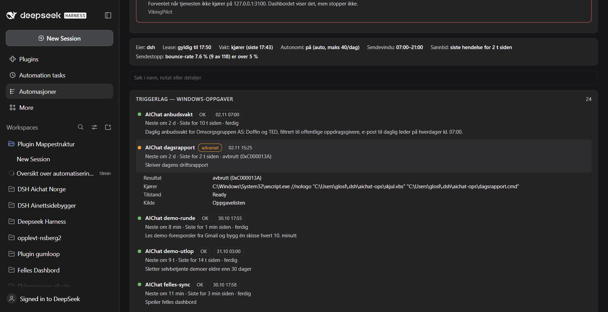
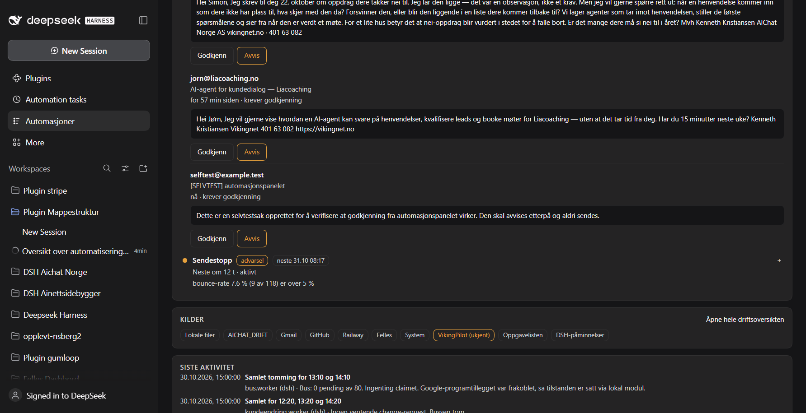
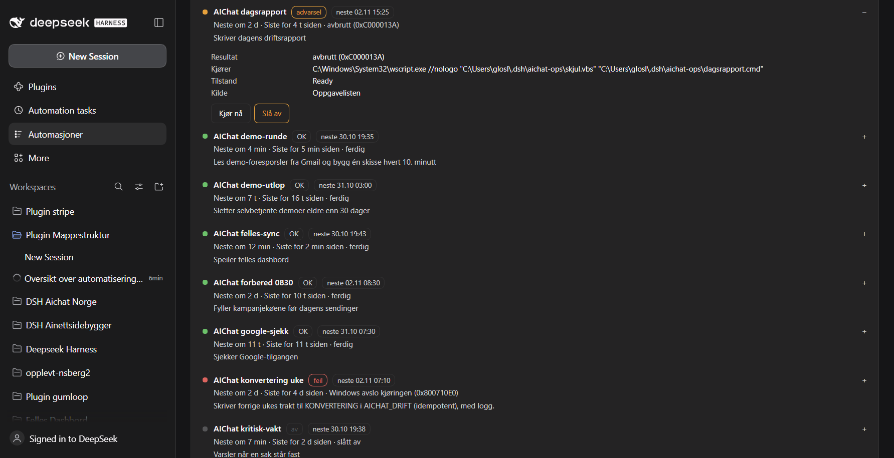
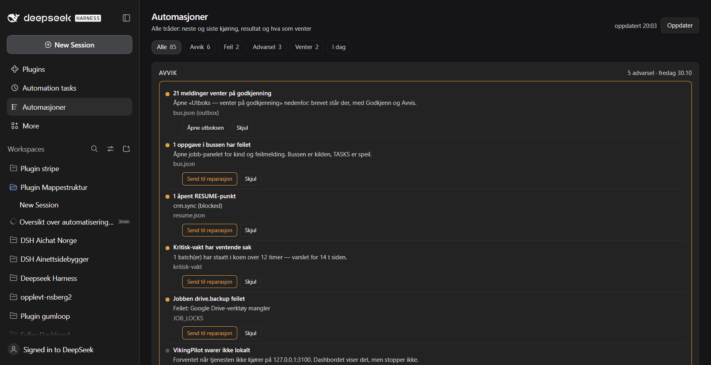
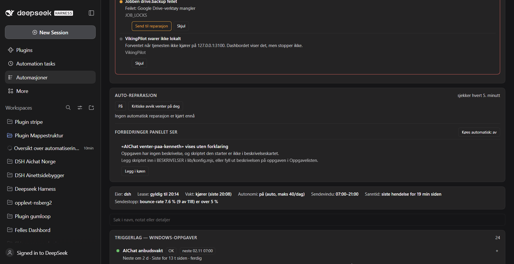

# Automasjoner — panel i DSH-dashbordet

Én flate for alle automatiseringene: hver automatisering er en **tråd** med
neste kjøring, siste kjøring, resultatet og hva den venter på. Panelet ligger i
DSH-GUI-et med eget ikon i venstre kolonne — ikke inne i en samtale.

Panelet leser alt og lar deg gjøre tre ting uten å forlate dashbordet:
**godkjenne eller avvise en utboksmelding**, **sende en godkjent melding**, og
**kjøre, slå av eller slå på en Windows-oppgave**. Alt annet er lesing.



Hver rad kan åpnes; da vises resultatkoden i klartekst, kommandoen som faktisk
kjører, tilstanden og kilden:



## Handlinger fra panelet

| Handling | Hva som skjer | Hva som sperrer |
|---|---|---|
| **Godkjenn** (utboks) | `aichat_outbox_mark` setter `approved` og `approved_by` | Sender ingenting. Krever innlogget GUI |
| **Avvis** (utboks) | `aichat_outbox_mark` setter `cancelled` med `avvist_av` | To klikk |
| **Send** (godkjent rad) | `aichat_outbox_send_approved`: sendestopp, SUPPRESSION, SEND_LOG-dublett, SEND_LOG skrives før sending | To klikk, og verktøyet nekter alt som ikke er `approved` |
| **Kjør nå** (Windows-oppgave) | `Start-ScheduledTask` | To klikk. Oppgaven kjører hele automatiseringen sin, også e-post |
| **Slå av / Slå på** | `Disable-/Enable-ScheduledTask` | To klikk |

Panelet har **ingen egen sendesti og ingen egen godkjenning**: det kaller de
samme verktøyene agenten bruker, med de samme sperrene. Derfor havner
godkjenningen i `approved_by` og sendingen i `SEND_LOG` på vanlig måte.

Her er utboksen med brevet synlig og handlingene på hver melding:



Og her er handlingene på en Windows-oppgave:



Navnet som skrives i `approved_by` kommer fra `godkjenner` i
`~/.dsh/automasjon/config.json` (standard `Kenneth`). Endre det hvis det er feil.

### Sikkerheten rundt skriving

- `POST /automasjon/handling` krever `Content-Type: application/json`, samme
  opphav i `Origin`, og at `connection.requestRejection` kjenner
  nettleserøkten. Et kall utenfra får **401**, og ingenting skjer.
- Bare tre lukkede handlingsnavn finnes (`godkjenn`, `avvis`, `send` for utboks;
  `kjor`, `av`, `paa` for oppgave). Ruten er ikke en generell verktøyproxy.
- Oppgavenavnet må finnes i den faktiske Oppgavelisten og matche de konfigurerte
  prefiksene; navnet sendes som en enkelt sitert literalt til PowerShell.
- Ingen «godkjenn alle». En melding om gangen, med brevet synlig i panelet.

## Avvik: skjul, reparer, la det gå av seg selv



| Knapp | Virkning |
|---|---|
| **Skjul** | Avviket flyttes til «N skjult» og blir borte fra lista. Lagres på disk i `~/.dsh/automasjon/skjulte.json`, så alle faner ser det samme. «Vis igjen» henter det tilbake. |
| **Les kilden på nytt** | Tvinger ny lesing av kilden som feilet. Trygt, og derfor lov å gjøre automatisk. |
| **Kjør oppgaven på nytt** | `Start-ScheduledTask` på oppgaven avviket gjelder. To klikk. |
| **Send til reparasjon** | Legger en `repair`-oppgave i oppgavebussen med avviket, årsaken og en instruks om ikke å sende eller deploye uten godkjenning. Arbeidskjeden tar den. |

**Auto-reparasjon** går i vertsprosessen hvert femte minutt, ikke i nettleseren:

- Kilder som feiler leses på nytt — automatisk.
- Kritiske avvik sendes til oppgavebussen når bryteren «Kritiske avvik går til
  køen» er på. Den er **av** som standard.
- Windows-oppgaver startes aldri automatisk uten at oppgaven står i
  `autoRepairOppgaver` i `config.json` (tom som standard) — en oppgave kan sende
  e-post.
- Hvert forsøk logges i `~/.dsh/automasjon/reparasjon.log`, og siste runde vises i
  panelet.

Alt annet får ingen knapp som later som den reparerer: sendestopp heves av seg
selv når returraten er frisk, og en tjeneste som ikke kjører startes der den hører
hjemme.

## Panelet oppdager nye automatiseringer selv

Windows-oppgavene hentes ikke bare på navneprefiks (`AIChat*`, `DSH*`): alt som
starter et skript under `~/.dsh/aichat-ops` eller `~/.dsh` tas med, og merkes
«oppdaget via skriptstien». Nye oppgaver og nye oppgavetyper i bussen dukker
derfor opp uten at noen endrer panelet. Det som fortsatt krever en kodeendring,
går gjennom «Send til reparasjon».

## Forbedringer panelet foreslår



Panelet ser etter fem ting det ikke dekker godt nok, og forklarer hva som bør
gjøres:

1. Oppgaver det ikke kan forklare hva gjør (ingen beskrivelse, ukjent skript).
2. Kilder som ikke kunne leses.
3. Oppgaver som bare ble funnet via skriptstien, ikke via navneprefiks.
4. Jobber i JOB_LOCKS uten beskrivelse og uten siste notat.
5. Deler av panelet som ikke ble lest i det hele tatt.

«Legg i køen» legger en `plugin`-oppgave i oppgavebussen med forslaget, og
bryteren «Køes automatisk» gjør det samme av seg selv — én gang per forslag per
dag, så køen ikke fylles.

**Grensen, med vilje:** panelet skriver ikke om sin egen kode ved kjøring. Det
oppdager hullet, beskriver det presist og setter det i køen der en agent med
vanlige sperrer tar det. En automatisk, usett endring av et grensesnitt du styrer
driften fra er ikke en forbedring.

### Køen og gjennomstrømningen

`repair` og `plugin` havner i den samme oppgavebussen som resten av driften.
«Bus-arbeider hver time» tar **én** oppgave i timen, eldste først, og avslutter
den med `aichat_bus_complete` eller `aichat_bus_fail` med årsak. Panelet legger
derfor aldri inn en oppgave som alt ligger i køen: samme avvik eller forslag
svarer «Ligger alt i køen — ingen ny oppgave lagt til».

Konsekvensen er at ventetiden måles i timer, ikke minutter, når flere avvik
køes samtidig. Det er arbeiderens takt, ikke panelets: panelet viser antall
ventende i køgruppen, så du ser hvor lang køen er før du legger mer i den.


## Hva som vises

| Gruppe | Kilde | Hva du ser |
|---|---|---|
| Triggerlag — Windows-oppgaver | Oppgavelisten (`Get-ScheduledTask`) | 24 oppgaver med siste kjøring, resultatkode, neste kjøring og skriptet den starter |
| Påminnelser i DSH | `schedule.catalog()` | Alle Host-påminnelser på tvers av sesjoner, med mønster og forfall |
| Jobber (JOB_LOCKS) | AICHAT_DRIFT via driftsdashbordets kildemoduler | 17 jobber med kjøringsperiode, eier og siste notat |
| Kø og godkjenning | `bus.json`, `send-hold.json`, `resume.json` | Buss, feilede bussoppgaver, utboks som venter på godkjenning, sendestopp, kill switch, åpne RESUME-punkter |
| Avvik | avviksreglene i driftsdashbordet + egne regler | Det som haster, sortert kritisk → advarsel → info |
| Kilder | alle | Ferskhet og feil per kilde; en død kilde er rød, ikke grønn |
| Nettsteder — synlighet | egne sider over HTTPS | HTTP, tittel, robots, canonical, strukturdata, og:-bilde, H1 og sitemap, per side |

Hver rad kan åpnes og viser detaljer: resultatkoden i klartekst, hvilken kommando
som faktisk kjører, kjøringsperiode, eier og opphav.

## Nettsteder — synlighet

Egen gruppe med ett kort per nettsted. For hver side leses det en crawler ser:

| Felt | Hva det betyr |
|---|---|
| HTTP | Svarer siden i det hele tatt |
| Tittel og meta-beskrivelse | Hva søkeresultatet kan vise |
| robots / noindex | Om siden ber søkemotorene la den være |
| Canonical | Hvilken adresse som er den riktige |
| Strukturdata | Antall JSON-LD-blokker — det AI-svar leser |
| og:title / og:image | Hvordan lenken ser ut når den deles |
| H1 | Nøyaktig én er riktig |
| Sitemap | Antall URL-er, og hvilke datoer de har |
| Døde lenker | Interne lenker som ikke svarer |

Alt som mangler listes i klartekst; ingen skår eller diffuse «SEO-poeng».

**Hvor ofte:** sidene leses på nytt hvert 30. minutt. Lenkene sjekkes med
HEAD-forespørsler og har egen cache på seks timer, så panelet ikke hamrer på
kundesidene. Hver rad har **Sjekk på nytt**. En side som ikke svarer blir et
avvik som kan sendes til reparasjon, som de andre avvikene.

**Hvilke sider:** registeret ligger i `~/.dsh/automasjon/sider.json`:

```json
{ "sider": [{ "domene": "vikingnet.no", "navn": "Vikingnet", "egen": true }] }
```

Filen leses på nytt ved hver oppdatering, så nye sider kan legges til mens DSH
kjører. Uten fil brukes de åtte egne domenene. Registeret inneholder nå egne
domener og kundesider; bare domener som faktisk svarte da de ble lagt inn.

### Forslag som kan køes

Hver målt mangel blir et eget forslag med én konkret anbefalt handling, sortert
med de døde sidene først. Reglene:

| Regel | Slår til når |
|---|---|
| `svarer-ikke` | Siden nås ikke |
| `noindex` | robots sier noindex |
| `mangler-jsonld` | Ingen strukturdata |
| `mangler-canonical`, `relativ-canonical` | Canonical mangler eller er relativ |
| `mangler-og` | og:title eller og:image mangler |
| `mangler-h1`, `flere-h1` | Feil antall H1 |
| `sitemap-tom` | Sitemap svarer uten URL-er |
| `mangler-beskrivelse` | Ingen meta-beskrivelse |
| `dode-lenker` | Interne lenker svarer ikke |
| `fa-interne-lenker` | Under tre interne lenker på forsiden |
| `gamle-sider` | Eldste side er over et halvt år |
| `lik-dato-pa-alle` | Alle sider har samme dato, så datoen sier ingenting |

«Legg i køen» legger forslaget i oppgavebussen som `repair` med
`type: 'synlighet'`, slik at det går gjennom samme kø og samme sperrer som
reparasjonene. Panelet legger aldri inn et forslag som alt ligger i køen.

### Fra måling til fiks: avvik, register og neste kjøring (2. november 2026)

Før dette ble målt, men aldri fikset: forslagene var en egen liste som
auto-reparasjonen ikke så på, og hver nettstedrad sa «ingen neste kjøring».
Nå gjelder:

- **Målt mangel er et avvik.** `synlighet:<domene>:<regel>` ligger i `avvik` med
  alvor (`svarer-ikke` = kritisk, resten advarsel/info), og går gjennom
  `lib/policy.mjs` som alt annet. Regelen `synlighet` sier om fiksen er trygg
  (`autoTrygg`), om repoet er koblet, og om siden er under lansering.
- **Hver side har `neste`.** Raden viser når den måles på nytt (nå + TTL), og
  «siste» når den ble målt.
- **Registeret `~/.dsh/automasjon/nettsteder.json`** kobler domene → repo, vert
  og oppskrift. Det bygges av `~/.dsh/aichat-ops/synlighet-kart.mjs` fra Railway
  (`source.repo` + custom-domener), `KUNDE_REGISTRY` og overstyringer i
  `nettsteder.overstyringer.json`. Uten kobling vises «Repo er ikke koblet» —
  panelet gjetter aldri et repo.
- **JavaScript-skall måles ikke som mangler.** En side som sender tom HTML og
  rendrer i nettleseren får «ukjent» for H1 og lenker, med grunn. Er den målt med
  ekte Chrome (`synlighet-render.mjs`, skriver `renderte.json`), bruker panelet
  den målingen i stedet — det er den en besøkende og Google ser. Uten dette ble
  fire sider stående med «mangler H1» som var en målefeil, ikke en mangel.
- **`kind: 'synlighet'` eies av fiksemotoren** i aichat-ops. Den timelige
  bus-arbeideren tar alle andre typer, så en fiks ikke venter bak andre oppgaver.

Målingen kan kjøres utenfor panelet:

```powershell
node C:\Users\glosl\.dsh\aichat-ops\synlighet-status.mjs         # tabell og sammendrag
node C:\Users\glosl\.dsh\aichat-ops\synlighet-status.mjs --json  # maskinlesbart
```

**Vakten som kjører hvert 10. minutt** (`AIChat synlighet-vakt` i Oppgavelisten)
måler, legger mangler i kø i `~/.dsh/automasjon/fiks-ko.json`, og lukker en sak
først når målingen ikke lenger ser den. Den skriver ikke kode og deployer ikke —
det gjør agenten som tar køen, fordi en fiks krever bygg, deploy, verifisering og
tilbakerulling. Rådgivende regler (`gamle-sider`, `lik-dato-pa-alle`,
`fa-interne-lenker`, `mangler-beskrivelse`, `flere-h1`) går aldri i kø; de blir
stående som forslag.

**Fiksemotoren** (`synlighet-fiks.mjs`) skriver det den kan selv, og bare det:
`public/sitemap.xml` + `public/robots.txt`, JSON-LD i `index.html`, og et
1200×630-delingsbilde med `og:image`/`twitter:image` — alle tre for Vite-sider.
Alt annet — Next.js-metadata, H1, innhold — krever en agent som leser koden, og
det gjettes ikke. Den kjører i plan-modus i den samme 10-minuttersrunden og
skriver bare med `--apply`. En sak regnes som fikset først når målingen ikke
lenger ser mangelen; en commit alene er ikke en fiks.

Køen er tom når alle målte mangler enten er fikset eller mangler en kobling.
Det siste er en ærlig tilstand: fem egne domener (vikingnet.no, vikingcrm.no,
qognito.no, vaktur.no, vikingnet-team.no) har ingen repo panelet kan peke på, og
de blir stående som «Repo er ikke koblet» til noen sier hvilket repo det er.

## Selvdrivende: grønt, til fiks, din tur

Panelet har tre tilstander, og bare tre. Toppen viser dem i én linje.

| Tilstand | Betyr | Hva du gjør |
|---|---|---|
| **Grønt** | Ok, reparert av seg selv, eller styrt av systemet med forklaring | Ingenting |
| **Til fiks** | Lagt i kø med eier og tidspunkt — eller køes i denne runden | Ingenting |
| **Din tur** | Faktura-grunnlag fra en vunnet avtale | Kvitter «Fakturert» |

Grønt betyr «ingenting for deg å gjøre», ikke «verden er frisk». Alt som
repareres skrives til `~/.dsh/automasjon/reparasjon.log`, og «Siste aktivitet»
beholder sporet. Rød er ikke lenger en tilstand.

### Disponeringstabellen

Hvert avvik har en regel i `lib/policy.mjs`. En test feiler hvis et avvik
mangler disposering, så ingen kan bli stående uten eier.

| Regel | Auto | Tilstand |
|---|---|---|
| `kilde-*` | les kilden på nytt | til fiks |
| `win-*` | kjør oppgaven hvis den står på hvitelisten, ellers kø | til fiks |
| `nett-*`, `ko-stopp`, alt annet | kø | til fiks |
| `outbox-prepared` | ingen — utkast venter på et menneske | til fiks |
| `send-hold`, `vikingpilot-down`, `bus-pending-old` | ingen, med forklaring | grønt |

Etter to mislykkede forsøk **parkeres** saken i køen i stedet for å prøves på
nytt. Køen tømmes av bus-arbeideren, og panelet viser når neste kjøring er.

**Kø-vakt:** har bus-arbeideren ikke levert innen 20 minutter etter forventet
kjøring, legges `ko-stopp` i køen automatisk. En arbeider som stille har
sluttet å virke er den feilen ingen andre ser.

### Faktura — det eneste som krever deg

`tilbud_aksept` i Plugin gumloop skriver `FAKTURAGRUNNLAG` når en avtale er
vunnet. Panelet **leser** arket, skriver aldri til det.

1. En ny rad merkes med nøkkelen `tidspunkt|kunde` og lagres i
   `~/.dsh/automasjon/faktura.json`.
2. Du får **én** e-post per rad, til `varselEpost` — aldri til kunden.
   Samme rad varsler aldri to ganger.
3. Raden står i «Din tur» til du trykker **Fakturert** (to klikk). Kvitteringen
   er lokal; regnearket røres ikke.

### Grensen mot Plugin gumloop

Settet eier innboks, kundepost, deploy og tilbud. Panelet eier løkken:
oppdage, disponere, køe, varsle om faktura. `test/dekning.test.js` feiler hvis
panelet kaller `gmail_list`, `gmail_reply`, `aichat_autosvar`, `tilbud_*`,
`railway_redeploy` eller `firebase_deploy`. Eneste unntak er fakturavarselet,
som testes for å gå til din adresse.

## Hvordan det virker

```
Nettleser (DSH-GUI)
  main[key=automasjon]  ── fetch ──► GET /automasjon/state.json
  sidebar.panellist[id=automasjon]        │
                                          ├─ ~/.dsh/dashbord/lib/snapshot.mjs (buildSnapshot)
                                          ├─ ctx.schedule.catalog()
                                          ├─ PowerShell/CIM: Windows-oppgavene
                                          └─ bus.json, autonomi.json, heartbeat.json, resume.json
```

- **Host** (`index.js`, `lib/*.mjs`) leser alt og svarer med ferdige tråder.
  Nettleseren får aldri tokens eller råfilinnhold.
- **Klient** (`client.js`) er ren React uten byggesteg, i `main`-sloten med
  ikonet i `sidebar.panellist`. Den bruker bare tema-tokens og egen locale-ordbok.
- **Caching:** Windows-oppgavene 30 s, hele svaret 15 s, driftsbildet 20 s (og
  kildemodulene har sin egen TTL). `?force=1` tvinger nye lesinger.

## Installasjon

```powershell
# fra DSH: plugin_manager install_bundle med denne mappen som target
#   C:\Users\glosl\OneDrive\AIChat Norge AS\Vikingent\Plugin Mappestruktur\packages\dsh-plugin-automasjon
```

Etter installasjon: åpne DSH-GUI-et og klikk ikonet **Automasjoner** i venstre
kolonne. Endringer i `client.js` krever omstart av DSH; endringer i Host-delen
krever det samme for en ny modulgenerasjon.

## Innstillinger

Valgfri `~/.dsh/automasjon/config.json` (ingen `Config`-schema, fordi bundlen
installeres fra en mappe utenfor profilen):

```json
{
  "dashbordDir": "C:\\Users\\glosl\\.dsh\\dashbord",
  "oppgavePrefikser": ["AIChat", "DSH"],
  "ttlLettMs": 15000,
  "ttlVinduerMs": 30000,
  "ttlTungtMs": 20000
}
```

`dashbordDir` peker på kildemodulene som leser Google, GitHub, Railway og Felles.
Mangler mappen, faller panelet tilbake til de lokale filene og sier fra i
«Ikke lest» — det viser aldri tomme tall som om de var ekte.

## Grenser

- Panelet viser automatiseringslaget. E-post, salg og outreach-pipelinen ligger
  fortsatt i driftsdashbordet på <http://127.0.0.1:4188>; panelet har en lenke dit.
- Panelet kan godkjenne, avvise og sende utboks, og styre Windows-oppgavene.
  Det kan ikke opprette nye meldinger, endre priser, deploye, svare kunder eller
  kjøre vilkårlige kommandoer.
- Leseruten svarer bare på `GET`/`HEAD`, bare på `127.0.0.1`/`localhost`/`::1`
  (Host-headeren sjekkes), og med `Cache-Control: no-store`.
- `~/.dsh/automasjon/verify-url.txt` inneholder en tokenisert adresse til det
  lokale GUI-et, slik at panelet kan verifiseres med skjermbilde. Filen kan
  slettes når som helst; den skrives på nytt ved oppstart.

## Tester

```powershell
cd "C:\Users\glosl\OneDrive\AIChat Norge AS\Vikingent\Plugin Mappestruktur\packages\dsh-plugin-automasjon"
node --test
```

Testene bruker faste verdier: resultatkoder, statusregler, avviksrekkefølge og
degradert modus. Ingen nett, ingen sanntidsfiler.

## Rollback

```powershell
# fra DSH: plugin_manager remove_bundle med pakkenavnet dsh-plugin-automasjon
Remove-Item -Recurse -Force "$env:USERPROFILE\.dsh\automasjon"
```

Ingen kundedata, e-post, regneark eller DSH-innstillinger er endret.
